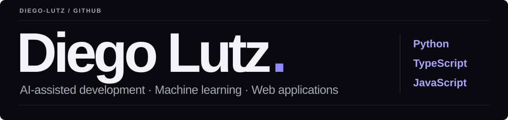

  <a href="#projects">Projects</a> &nbsp; / &nbsp;
  <a href="#technologies">Technologies</a> &nbsp; / &nbsp;
  <a href="https://github.com/diego-lutz?tab=repositories">All repositories ↗</a>

## About me

I develop personal projects with AI, including industrial simulations, machine learning experiments, study tools and interactive interfaces.

My work involves defining requirements, guiding AI-assisted development, reviewing results and debugging. I'm currently interested in **AI training and response evaluation**, with a focus on accuracy, clear reasoning and useful feedback.

## Projects

### 01 / [Predictive Maintenance Simulator ↗](https://github.com/diego-lutz/simulador-manutencao-preditiva)

A Python study project that simulates industrial machines, generates sensor data and uses a Random Forest classifier to distinguish normal operation, warning signs and imminent risk. Its dashboard tracks accuracy, false alarms and missed risks.

Developed in collaboration with AI, with human direction of the architecture, simulation logic and debugging.

`Python` &nbsp; `Pandas` &nbsp; `Scikit-learn` &nbsp; `Tkinter`

---

### 02 / [Study Assistant ↗](https://github.com/diego-lutz/Study-Assistant)

A study assistant project built with TypeScript.

`TypeScript` &nbsp; `Study tools`

---

### 03 / [FPGA Interface ↗](https://github.com/diego-lutz/interface-fpga)

An interactive interface for demonstrating digit recognition through image and audio on an FPGA, alongside the project's thesis presentation.

`HTML` &nbsp; `Interactive interface` &nbsp; `FPGA demonstration`

## Technologies

Languages and tools used across my projects:

**Data & models** &nbsp; Pandas · Scikit-learn · Random Forest

**Development** &nbsp; AI-assisted coding · Prototyping · Debugging · Iterative refinement

## Current focus

I'm looking for opportunities in **AI training, response evaluation and related work** where I can apply my practical experience with AI tools and software projects.

